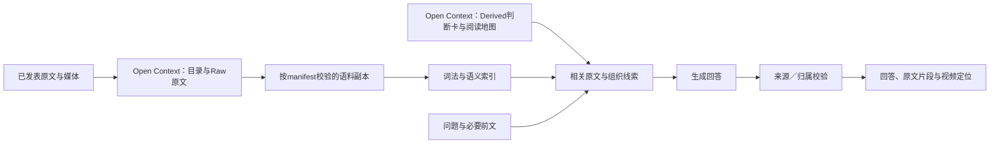

# Context Infra：从资料到回答

已发表原文和媒体是主要事实依据，Open Context统一维护可回源的原稿和共享结构化记录。Context Infra负责解析、索引、检索、组织证据和回答；问问立正是它的在线产品。数据版本、检索策略和产品展示各在其所属层更新。

## 资料合同

公开原文、人物和节目关系统一在Open Context维护。`catalog/guests.json`维护人物、别名、节目及参与关系；`corpus/`保存原文与精校文本；`context/`保存回指原文的提炼。网站与本服务消费同一份公开release。原始发表提供事实依据，仓库版本固定当次使用的记录；来源中的观点保留表达者与发表时间。

Raw可直接检索，Derived用于导航与组织。检索片段保留`data_layer`、`speaker_id/name/status`、`fragment_id`及源文件SHA。节目参与关系用于按人物发现资料；具体发言归属来自原文单元。字幕单元归属未知时显示“说话人待核”。相同来源的原文、译文和多个片段按source family管理。

`data/context`是manifest列出的资料副本，`data/context-lock.json`固定上游commit和manifest hash。语料和索引都是部署产物，可从上游重建；采集缓存与本地素材库由各自项目维护。

## 增量索引

同步绑定已提交的上游manifest，将经hash校验的同一份字节写入候选目录，再核对完整候选及版本记录。构建副本替换遇到可捕获错误时恢复此前语料与记录。此同步在离线构建中运行，部署加载固定副本。随后从解析器生成原始文字窗口。结构化对谈按说话人和时间切块，编者说明与原话分别索引。语义缓存按输入文字hash继承已有向量，只计算新窗口；metadata和manifest版本随本次release更新。

Open Context推送main后触发`update-context`：验证上游、同步、增量构建、运行测试、部署Builder，最后核验`/api/meta`的commit、release和`semantic_ready`。变更内容需在进入上游release前完成审阅；部署流程见[整体架构](ARCHITECTURE.md)。

## 在线检索与回答

来源用途先于相关性排序。「想明白／结合处境」只召回立正直接发表的正文与具备已核归属状态的本人发言；「从哪读起」检索全库，包含对谈、第三方作品和派生导航。词法、语义和判断卡的候选都经过同一来源范围。对谈中立正的明确发言可用于普通回答，他的提问、介绍或转述按各自用途保留在资料索引。

词法检索保留姓名、精确术语和时间定位，语义检索补足不同说法的召回。问题明确提到嘉宾时，先从人物目录解析姓名与别名，在其关联节目中检索。人物目录给所有关联节目提供一致的姓名和别名；仅有元数据的节目作为阅读入口，原文片段才作为回答依据。通用话题检索中，一个对谈可以返回最多三个相关且不重叠的窗口，并保留各自发言者。按嘉宾找资料直接返回去重后的节目与原文片段，沿用实际归属和时间定位。

29张判断卡按问题补入原文、条件、反例与案例。卡片由AI整理并回指具体材料，回答模型使用的是已经进入证据包的原文。原文与提炼分层运行，因此新节目无需先生成卡片才能被搜索。

只有标题和归档访问说明的条目用于定位资料；回答依据来自正文。

模型选择来源编号，服务器提供实际链接、日期、片段和视频时间码。材料转述、AI综合及结合用户处境的推演分别呈现。来源及发言归属随完整回答进入存档、历史、公开问答与分享图。

## 稳定性与验收

正确性首先来自明确的数据与调用职责：共享事实只在Open Context维护，所有召回路径使用同一来源用途规则，原文、提炼和AI回答保持各自归属。索引和页面从固定资料版本生成。采集在资料更新时进行，在线回答使用已有快照，来源网页的实时可用性不进入回答依赖。

索引适应Builder的256MB容器，语义服务失败时仍可使用词法检索。资料版本与模型服务就绪状态由`/api/meta`公开。确定性的合同检查核对来源关系、版本和索引覆盖；真实问题与模型输出用于评估回答质量。测试是实现的验收证据，来源依据和数据模型决定它应当怎样工作。

[context-infrastructure](https://github.com/grapeot/context-infrastructure)提供分层积累、提炼与按需加载的参考；这里的资料合同、供应链和部署实现由Open Context与问问立正维护。
